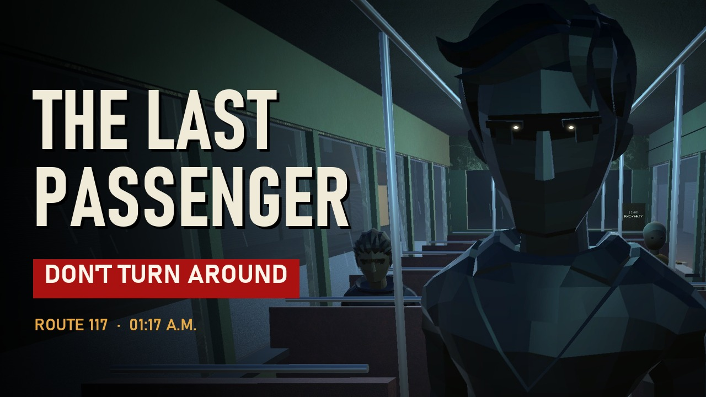

# THE LAST PASSENGER

*Night shift. Route 117. 01:17 A.M.*
*"Conductor... don't count the people you can hear."*

[](https://github.com/Agneay-Community-Hub/The-Last-Passenger/releases/download/v1.0.0/TheLastPassenger_Trailer.mp4)

**[Watch the trailer](https://github.com/Agneay-Community-Hub/The-Last-Passenger/releases/download/v1.0.0/TheLastPassenger_Trailer.mp4)** (55 s, recorded in-game)  ·  **[Download for Windows](https://github.com/Agneay-Community-Hub/The-Last-Passenger/releases/latest)**

A first-person psychological horror game about a bus conductor working the last service of the night through Kaveripuram, a fictional South Indian city, just after the monsoon rain. You issue tickets, ring the bell, keep the passenger manifest, and count the people on board. The count doesn't stay right.

Made for **[GitHub Game Off 2026](https://itch.io/jam/game-off-2026)**. The theme is **SHIFT**.

## How it uses the theme

- **The night shift.** You're covering the last shift on a route that was meant to be shut down.
- **SHIFT is how you look.** There's no sprint button. Holding **SHIFT** moves your eyes to the rear-view mirror, and the mirror shows things the cabin doesn't.
- **Shifting reality.** Passengers who got off are still in their seats. The route display shows stops that aren't on the route card. The same cinema goes past three times.
- **A shift in who you are.** The badge pinned to your uniform has someone else's name on it.

## Download and play

Download `TheLastPassenger_Windows.zip` from the [latest release](https://github.com/Agneay-Community-Hub/The-Last-Passenger/releases/latest), unzip it and run `TheLastPassenger.exe` (Windows 10/11, 64-bit). Windows SmartScreen may warn about an unsigned app: choose **More info → Run anyway**.

## Controls

| Action | Key |
|---|---|
| Move / look | WASD / mouse |
| Interact (tickets, bell, doors, evidence, talk) | **E** or left click |
| Glance at the rear-view mirror | hold **SHIFT** |
| Passenger manifest | **TAB** (or **M**) |
| Skip a subtitle line | **SPACE** |
| Pause / settings | **ESC** |

A new game starts with a short **training run** at the depot. Murugan, the timekeeper, sets up every situation the job needs (a passenger to ticket, a head count, someone to find in the mirror, someone getting off), and each of the 15 steps has to be done before the next one starts. A yellow marker on screen always points at what to use next. Both can be switched off in Settings. **How to play**, on the title screen and in the pause menu, explains the conductor's job, the manifest and the mirror.

Settings cover mouse sensitivity, volume, subtitle size, invert Y and reduced motion (no head bob or bus sway). Your progress saves at the start of each chapter, and **Continue** puts you back at that chapter.

## The game

- **7 chapters**: The Extra Shift, Old Market, The Call, The Route Repeats, River Road, Final Count, The Last Passenger. A first playthrough takes about 25–35 minutes.
- **The job is the gameplay.** You choose fares on the ticket machine, mark each passenger aboard or exited in the manifest, confirm head counts, and ring the bell to stop the bus or send it on.
- **Mistakes are permanent.** Entries in the manifest can't be erased. Each wrong mark leaves one more person on the bus.
- **Every scare is written for a specific moment** and plays once: a knock at the rear door, a reflection that stays seated, a phone ringing on an empty seat, a cinema that keeps coming back, a stop with no name, a man behind you who has no ticket.
- **3 endings**, all chosen through in-world actions. Nothing is picked from a menu.

## Tech

- Unity **6000.4.3f1**, Built-in Render Pipeline, old Input Manager. No third-party packages; the only third-party assets are the CC0/OFL art listed under Credits.
- **All geometry is built in code** at runtime (`Assets/Scripts/Bus.cs`, `Route.cs`): the bus interior, the passengers, and the city scrolling past outside. The bus never moves; the world moves around it.
- **All audio is synthesised** at startup (`Assets/Scripts/Audio.cs`): diesel engine, rain, fluorescent hum, mechanical bell, dot-matrix ticket printer, knocks, air brakes, an old phone ring, whispers and a drone.
- The rear-view mirror is a second camera rendering to a texture. Objects on layer 8 can only be seen through the mirror.

```
TheLastPassenger/            Unity project
  Assets/Scripts/
    GameBoot.cs              builds the game at startup
    Story.cs                 chapters, horror events, manifest rules, endings
    Bus.cs                   bus, doors, lights, mirror, passengers
    Route.cs                 scrolling city, stops, authored places
    Player.cs                first-person controller, interaction, mirror glance
    UI.cs                    subtitles, manifest, ticket machine, menus (IMGUI)
    Audio.cs                 procedural sound
    Core.cs                  helpers, save data, settings
  Assets/Editor/ProjectBuilder.cs   creates materials and the scene, runs builds
  Assets/Shaders/Text3D.shader      depth-tested world text
```

## Building from the command line

```bash
UNITY="/c/Program Files/Unity/Hub/Editor/6000.4.3f1/Editor/Unity.exe"
"$UNITY" -batchmode -quit -projectPath TheLastPassenger -executeMethod TLP.EditorTools.ProjectBuilder.BuildWebGL  -logFile webgl.log
"$UNITY" -batchmode -quit -projectPath TheLastPassenger -executeMethod TLP.EditorTools.ProjectBuilder.BuildWindows -logFile win.log
```

Every build first runs `ProjectBuilder.Setup`, which regenerates the materials and `Assets/Scenes/BusRoute_Main.unity`. Builds are written to `Builds/`. To upload to itch.io, zip the *contents* of `Builds/WebGL` and mark the upload as "played in the browser". The build is gzip-compressed with decompression fallback enabled, so itch.io needs no special server headers. 16:9, 1280×720 works well.

### Automated test playthrough (development builds only)

`ProjectBuilder.BuildWindowsDev` produces a development build with a test bot that plays the entire game and saves screenshots:

```bash
Builds/WindowsDev/TheLastPassenger.exe -screen-fullscreen 0 -tlpbot A -tlpshots shots -logFile bot.log
```

`-tlpbot A|B|C` picks the ending. `-tlpchapter N` starts from chapter N. Development builds also map F1–F7 to chapter jumps. Release builds include none of this.

### Trailer

The trailer is recorded inside the game. A development build plays a scripted shot list at a locked 30 fps and saves every frame, a cue list and the game's own synthesised sounds; `tools/make_trailer.py` adds captions and the title card, mixes the sound to the cues and encodes it with ffmpeg:

```bash
Builds/WindowsDev/TheLastPassenger.exe -screen-fullscreen 0 -popupwindow -screen-width 1280 -screen-height 720 -tlptrailer -tlpsuper 2 -tlpshots trailer_work/frames
python tools/make_trailer.py trailer_work/frames trailer_work/TheLastPassenger_Trailer.mp4
```

## Credits

Design, story and code: Agneay B Nair, built with Claude Code.
Story and design based on *The Last Passenger* game design document and India production bible.

Third-party assets (all CC0 or OFL; licence files are next to them in `Assets/ThirdParty`): characters and the Universal Animation Library by Quaternius, construction props from City Kit Roads by Kenney, PBR textures from ambientCG, and the Noto Sans Tamil font.

Licensed under the MIT License (see `LICENSE`).
